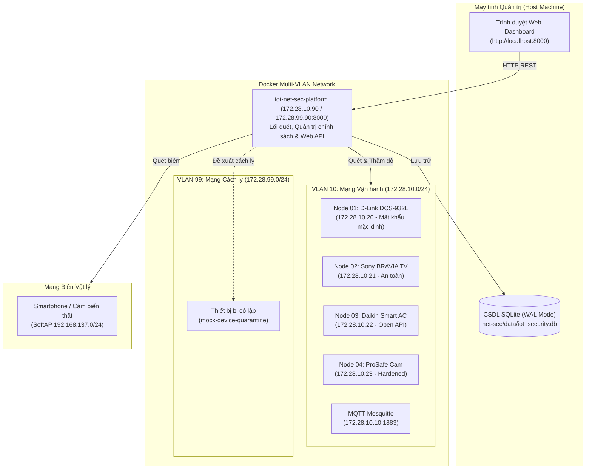
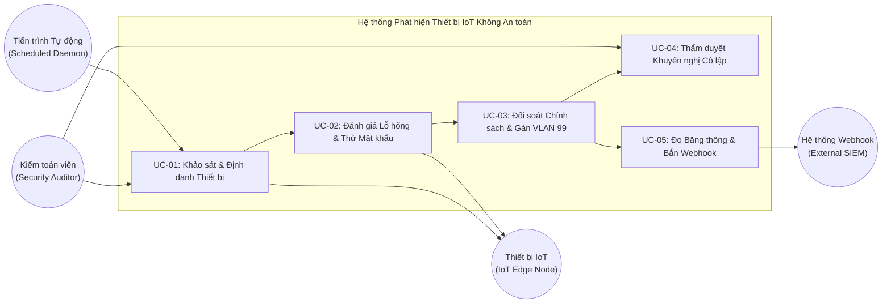
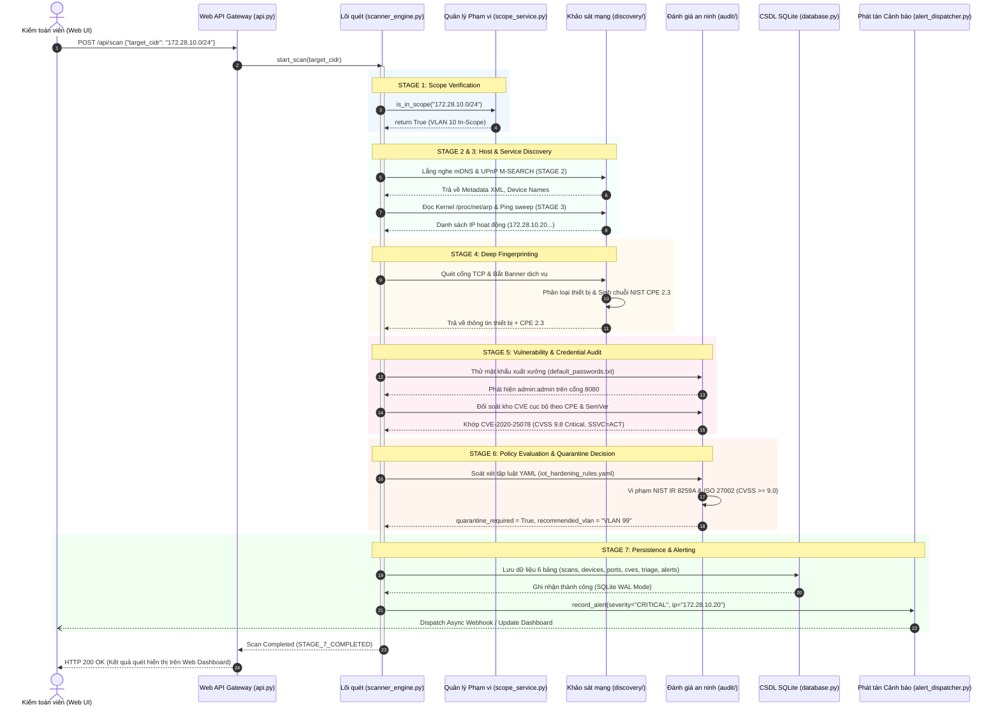
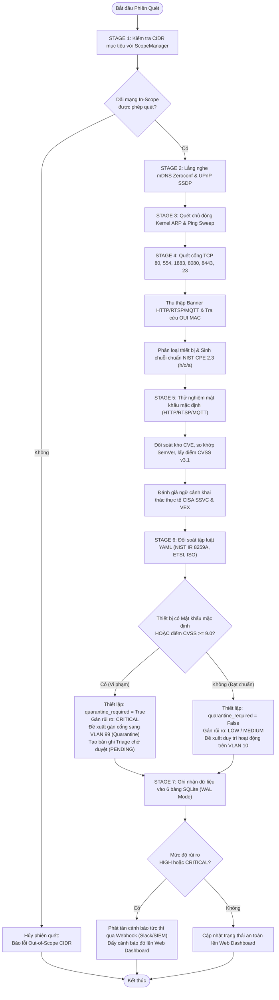
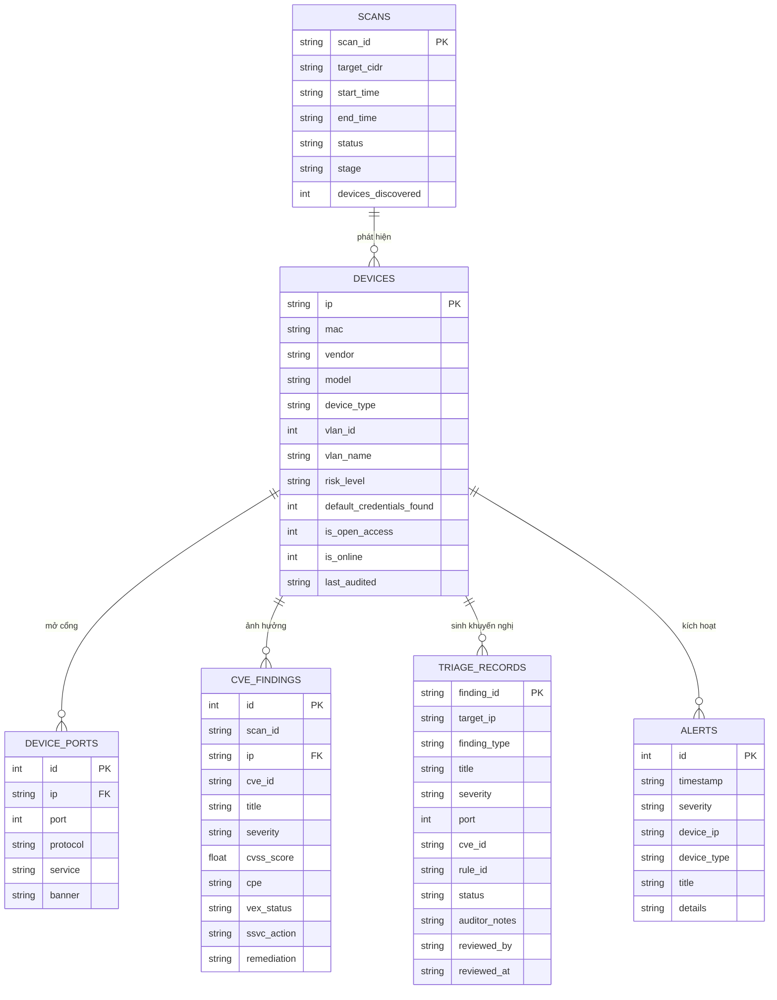
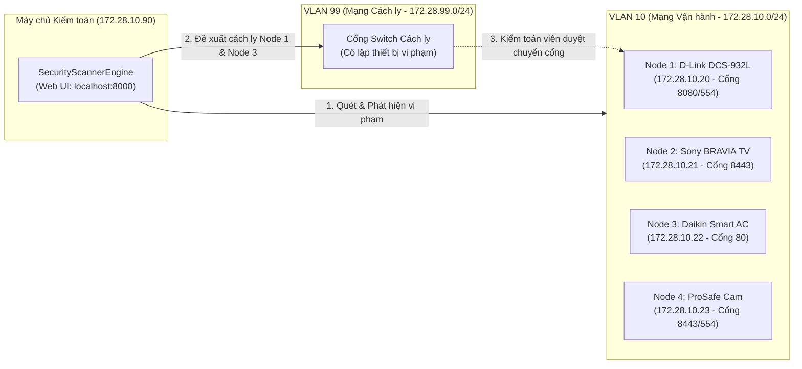

# HỌC PHẦN: CHÍNH SÁCH VÀ QUẢN TRỊ AN TOÀN THÔNG TIN (IT6027)
## ĐỀ TÀI: HỆ THỐNG PHÁT HIỆN THIẾT BỊ IOT KHÔNG AN TOÀN TRONG MẠNG
**Mã nguồn:** `iot-system` | **Phiên bản:** `v0.2.4`

---

## 1. TỔNG QUAN HỆ THỐNG

Hệ thống gồm 2 thành phần chính hoạt động độc lập:
1. **Mạng IoT Thử nghiệm (Target of Evaluation - ToE):** Gồm mạng Wi-Fi SoftAP biên thực tế (`192.168.137.0/24`), máy chủ MQTT Mosquitto (`172.28.10.10:1883`) và dàn thiết bị IoT giả lập đa chủng loại triển khai trên Docker.
2. **Hệ thống Kiểm toán & Quản trị An ninh (`net-sec`):** Máy chủ quét độc lập kết nối song song vào 2 phân vùng mạng:
   - **VLAN 10 (`172.28.10.0/24`):** Phân vùng vận hành chuẩn (Operational Network).
   - **VLAN 99 (`172.28.99.0/24`):** Phân vùng mạng cách ly (Quarantine Network).
   - Quản trị viên theo dõi qua Web Dashboard (`http://localhost:8000`), dữ liệu lưu trữ tại SQLite (`net-sec/data/iot_security.db`).

---

## 2. THIẾT KẾ VÀ ĐẶC TẢ HỆ THỐNG (MỤC 2A)

### 2.1. Kiến trúc Toàn hệ thống

### 2.2. Quy trình Quét 7 Giai đoạn (`SecurityScannerEngine`)

1. `STAGE_1_SCOPE_VERIFICATION`: Kiểm tra dải CIDR mục tiêu hợp lệ qua `ScopeManager` (ngăn quét nhầm WAN).
2. `STAGE_2_MULTICAST_DISCOVERY`: Thu thập thụ động bản tin mDNS Zeroconf (UDP 5353) và UPnP SSDP (UDP 1900).
3. `STAGE_3_HOST_ACTIVE_SWEEP`: Đọc bảng Kernel ARP (`/proc/net/arp` / `arp -a`) và ICMP ping sweep xác định IP sống.
4. `STAGE_4_DEEP_FINGERPRINTING`: Quét cổng TCP (80, 554, 1883, 8080, 8443, 23), bắt banner, tra cứu OUI MAC, phân loại thiết bị (`classify_device`) và sinh chuỗi chuẩn NIST CPE 2.3 tam tầng ($h/o/a$).
5. `STAGE_5_VULNERABILITY_AND_CREDENTIAL_AUDIT`: Thử mật khẩu xuất xưởng phi phá hủy, phát hiện open stream, đối soát CSDL CVE theo phiên bản SemVer, tính điểm CVSS v3.1 và phân loại CISA SSVC (*ACT*, *ATTEND*, *TRACK*) / VEX.
6. `STAGE_6_POLICY_EVALUATION`: Soát xét tập luật bảo mật YAML (`iot_hardening_rules.yaml` đối chiếu NIST IR 8259A, ETSI EN 303 645, ISO 27002), ra quyết định đề xuất cách ly chuyển sang VLAN 99.
7. `STAGE_7_COMPLETED`: Ghi nhận dữ liệu vào 6 bảng SQLite, cập nhật Web Dashboard, bắn Webhook cảnh báo.

### 2.3. Bảng Tra cứu Module Mã nguồn Thực tế

| Module Chức năng | Đường dẫn Tệp (Relative) | Lớp / Hàm Chính | Nhiệm vụ Kỹ thuật |
| :--- | :--- | :--- | :--- |
| **Xác thực Scope** | `net-sec/app/scoping/scope_service.py` | `ScopeManager.is_in_scope()` | Kiểm tra CIDR hợp lệ trước khi quét. |
| **Lắng nghe mDNS** | `net-sec/app/discovery/mdns_listener.py` | `MDNSIotListener` | Đọc quảng bá dịch vụ Zeroconf UDP 5353. |
| **Quét UPnP SSDP** | `net-sec/app/discovery/upnp_scanner.py` | `UPnPScanner.discover()` | Gửi `M-SEARCH`, đọc XML metadata thiết bị. |
| **Quét Cổng TCP** | `net-sec/app/discovery/port_scanner.py` | `scan_iot_ports()` | Thăm dò TCP SYN/Connect bất đồng bộ các cổng IoT. |
| **Bắt Banner** | `net-sec/app/discovery/banner_grabber.py` | `inspect_all_banners()` | Bắt HTTP Server header, RTSP DESCRIBE, MQTT CONNECT. |
| **Phân giải OUI MAC**| `net-sec/app/discovery/oui_resolver.py` | `resolve_mac_vendor()` | Tra cứu nhà sản xuất qua MAC OUI; nhận diện MAC ngẫu nhiên. |
| **Phân loại Thiết bị**| `net-sec/app/scoping/classifier.py` | `classify_device()` | Phân loại: IP Camera, Smart TV, Smart AC, Smart Plug... |
| **Chuẩn hóa NIST CPE**| `net-sec/app/audit/cpe_normalizer.py` | `CpeNormalizer.build_cpe_uri()`| Sinh chuỗi chuẩn hóa NIST CPE 2.3 ($h$ - phần cứng, $o$ - firmware, $a$ - app). |
| **Thử Mật khẩu** | `net-sec/app/audit/credential_checker.py`| `test_device_credentials()` | Thử tài khoản xuất xưởng (`default_passwords.txt`) qua HTTP, RTSP, MQTT, Telnet. |
| **Khớp nối CVE** | `net-sec/app/audit/cve_matcher.py` | `match_cves_for_device()` | So khớp CPE vào `cve_database.json`, lọc phiên bản SemVer. |
| **Ngữ cảnh Khai thác**| `net-sec/app/audit/contextual_prioritizer.py`| `evaluate_cve_context()` | Đánh giá tính cấp bách theo CISA SSVC và tiêu chuẩn VEX. |
| **Thực thi Chính sách**| `net-sec/app/audit/policy_engine.py` | `PolicyEngine.audit_device()` | Đối soát luật an toàn định khai YAML (`iot_hardening_rules.yaml`). |
| **Phân định Cách ly** | `net-sec/app/scoping/vlan_scoper.py` | `evaluate_scoping_policy()` | Ra quyết định gán VLAN 99 khi có mật khẩu mặc định hoặc $CVSS \ge 9.0$. |
| **Thẩm duyệt Triage** | `net-sec/app/audit/triage.py` | `TriageManager` | Quản lý phê duyệt của kiểm toán viên (*PENDING* $\rightarrow$ *APPROVED* / *REJECTED*). |
| **Lưu trữ CSDL** | `net-sec/app/db/database.py` | `DatabaseManager` | Quản trị CSDL SQLite (chế độ WAL), tạo 6 bảng từ `schema.sql`. |
| **Đo Băng thông** | `net-sec/app/monitoring/traffic_meter.py` | `TrafficMeter` | Đo per-device tốc độ Rx/Tx thời gian thực qua `psutil`. |
| **Bắn Webhook** | `net-sec/app/monitoring/alert_dispatcher.py` | `WebhookAlertDispatcher` | Đẩy cảnh báo JSON mức HIGH/CRITICAL tới Slack/SIEM ngoài. |

---

## 3. MÔI TRƯỜNG TRIỂN KHAI (MỤC 2A)

- **Hệ điều hành Host:** Windows 10/11 (WSL2), macOS (Apple Silicon & Intel), Ubuntu Linux 22.04/24.04.
- **Ảo hóa & Container:** Docker Engine v24+, Docker Compose v2.20+.
  - `iot-net-sec:latest`: Nền `python:3.11-slim` (Debian 12, hỗ trợ đa kiến trúc amd64/arm64).
  - `iot-mock-camera:latest`: Nền `python:3.11-alpine` (dung lượng < 60MB).
  - `net-core-mqtt`: Nền `eclipse-mosquitto:2.0`.
- **Ngôn ngữ & Thư viện Chính (`net-sec/requirements.txt`):**
  - `fastapi` (>=0.110.0), `uvicorn` (>=0.28.0): REST API và Web Dashboard.
  - `httpx` (>=0.27.0): Thăm dò giao thức HTTP bất đồng bộ.
  - `zeroconf` (>=0.151.0): Lắng nghe mDNS Zeroconf.
  - `paho-mqtt` (>=2.0.0): Kết nối kiểm tra máy chủ MQTT.
  - `psutil` (>=5.9.0): Đo đếm lưu lượng mạng và hiệu năng RAM.
  - `PyYAML` (>=6.0.0): Phân tích cú pháp tệp chính sách YAML.
  - `sqlite3` (Chuẩn Python, WAL Mode): Lưu trữ bền vững 6 bảng dữ liệu.
  - `pytest` (>=8.0.0): Chạy bộ kiểm thử tự động 123 tests.
- **Hướng dẫn sử dụng cơ bản:**
  - Khởi động: `./docker-start.sh` (Linux/Mac) hoặc `docker-start.bat` (Windows).
  - Đóng gói thành Docker Image: `./docker-export.sh` (sinh tệp `iot-security-images.tar.gz`).

---

## 4. TỔNG QUAN USE CASES & PHÂN RÃ CHỨC NĂNG (MỤC 2A)

### 4.1. Tác nhân Hệ thống (Actors)
1. **Security Auditor (Kiểm toán viên):** Kích hoạt quét, xem dashboard, duyệt cách ly thiết bị (*Triage*).
2. **Scheduled Audit Daemon (Tiến trình Tự động):** Quét định kỳ và kiểm tra hiện diện nút mạng (`presence_monitor`).
3. **IoT Edge Devices (Thiết bị IoT Biên):** Đối tượng rà soát, phát mDNS/UPnP và phản hồi thăm dò mạng.
4. **External SIEM / Webhook Receiver (Hệ thống Cảnh báo Ngoài):** Tiếp nhận bản tin cảnh báo JSON vi phạm.

### 4.2. Sơ đồ Use Case Tổng quan

### 4.3. Sơ đồ Phân rã Chức năng (Functional Decomposition Tree)

```mermaid
flowchart TD
    Root["HỆ THỐNG PHÁT HIỆN THIẾT BỊ IOT KHÔNG AN TOÀN TRONG MẠNG"]

    Sub1["1. Khảo sát & Định danh Mạng\n(Network & IoT Discovery)"]
    Sub2["2. Đánh giá Lỗ hổng & Chính sách\n(Vulnerability & Policy Governance)"]
    Sub3["3. Nền tảng, Vận hành & Giám sát\n(Platform, Operations & Monitoring)"]

    Root --> Sub1
    Root --> Sub2
    Root --> Sub3

    Sub1 --> F11["1.1. Xác thực phạm vi quét (Scope Verification)"]
    Sub1 --> F12["1.2. Lắng nghe mDNS & UPnP SSDP"]
    Sub1 --> F13["1.3. Quét chủ động Kernel ARP & Ping sweep"]
    Sub1 --> F14["1.4. Quét cổng TCP & Bắt Banner dịch vụ"]
    Sub1 --> F15["1.5. Phân giải OUI MAC & Phân loại thiết bị"]
    Sub1 --> F16["1.6. Chuẩn hóa định danh NIST CPE 2.3"]

    Sub2 --> F21["2.1. Thử mật khẩu xuất xưởng mặc định"]
    Sub2 --> F22["2.2. Phát hiện Video/Actuator mở không xác thực"]
    Sub2 --> F23["2.3. Đối soát kho CVE & So khớp phiên bản SemVer"]
    Sub2 --> F24["2.4. Đánh giá CISA SSVC & Tiêu chuẩn VEX"]
    Sub2 --> F25["2.5. Kiểm tra tập luật an toàn YAML (NIST/ETSI/ISO)"]
    Sub2 --> F26["2.6. Ra quyết định đề xuất cách ly sang VLAN 99"]
    Sub2 --> F27["2.7. Quản lý thẩm duyệt Triage của kiểm toán viên"]

    Sub3 --> F31["3.1. Điều phối tiến trình quét 7 giai đoạn"]
    Sub3 --> F32["3.2. Cung cấp Web Dashboard & OpenAPI docs"]
    Sub3 --> F33["3.3. Lưu trữ CSDL quan hệ SQLite (WAL Mode)"]
    Sub3 --> F34["3.4. Đo đếm băng thông mạng per-device"]
    Sub3 --> F35["3.5. Phát tán cảnh báo sự cố qua Webhook"]
```

### 4.4. Bảng Tóm tắt 5 Use Case Chính

| Mã UC | Tên Use Case | Tác nhân | Luồng Xử lý Chính | Kết quả Đầu ra |
| :--- | :--- | :--- | :--- | :--- |
| **UC-01** | Khảo sát & Định danh Thiết bị | Auditor / Daemon | Xác thực Scope $\rightarrow$ Đọc mDNS/UPnP/ARP $\rightarrow$ Quét cổng TCP $\rightarrow$ Bắt banner $\rightarrow$ Sinh NIST CPE 2.3. | Danh mục thiết bị (IP, MAC, Type, Ports, CPEs). |
| **UC-02** | Đánh giá Lỗ hổng & Thử Mật khẩu | Lõi quét Engine | Thử mật khẩu mặc định qua HTTP/RTSP/MQTT $\rightarrow$ Kiểm tra open stream $\rightarrow$ Khớp kho CVE & CVSS v3.1 $\rightarrow$ Đánh giá CISA SSVC. | Danh sách lỗ hổng, mật khẩu yếu và điểm số rủi ro. |
| **UC-03** | Đối soát Chính sách & Gán VLAN 99 | Policy Engine | Kiểm tra vi phạm luật YAML (NIST/ETSI/ISO). Nếu có mật khẩu mặc định hoặc $CVSS \ge 9.0$: đặt `quarantine_required = True`. | Đề xuất gán cổng sang VLAN 99; tạo bản ghi Triage *PENDING*. |
| **UC-04** | Thẩm duyệt Khuyến nghị Cô lập | Auditor | Quản trị viên xem xét vi phạm trên Web UI $\rightarrow$ Bấm Approve (cách ly) hoặc Reject (bỏ qua) kèm ghi chú. | Trạng thái được cập nhật vĩnh viễn vào CSDL SQLite. |
| **UC-05** | Đo Băng thông & Bắn Webhook | TrafficMeter / Alert | Giám sát lưu lượng Rx/Tx per-device $\rightarrow$ Khi có vi phạm HIGH/CRITICAL, phát tán JSON tới Webhook ngoài. | Đội ứng cứu SOC nhận cảnh báo tức thời qua Slack/SIEM. |

---

## 5. PHÂN TÍCH & THIẾT KẾ LUỒNG VẬN HÀNH CHÍNH (MỤC 2B)

**Luồng trọng tâm:** *Rà quét tự động toàn trình và Ra quyết định đề xuất cách ly sang VLAN 99*.

### 5.1. Biểu đồ Tuần tự (Sequence Diagram)

### 5.2. Biểu đồ Hoạt động (Activity Diagram)

### 5.3. Thiết kế Cơ sở Dữ liệu Quan hệ (Database Schema / ERD)

CSDL quan hệ nhúng SQLite (chế độ WAL) quản lý bởi `DatabaseManager` (`net-sec/app/db/database.py`), khởi tạo từ `net-sec/app/db/schema.sql`.

#### Sơ đồ Thực thể Quan hệ (Mermaid ERD)

#### Tóm tắt 6 Bảng CSDL Quan hệ

| Tên Bảng | Khóa Chính (PK) | Khóa Ngoại (FK) | Mục đích Quản trị |
| :--- | :--- | :--- | :--- |
| **`scans`** | `scan_id` (TEXT) | Không | Lưu lịch sử các phiên rà soát (CIDR, thời gian, trạng thái, số lượng thiết bị). |
| **`devices`** | `ip` (TEXT) | Không | Kho danh mục thiết bị (MAC, Vendor, Model, Type, VLAN, Risk Level, cờ mật khẩu). |
| **`device_ports`** | `id` (INTEGER Auto) | `ip` $\rightarrow$ `devices.ip` | Lưu danh mục cổng mở, giao thức và banner chào hỏi thu thập được. |
| **`cve_findings`** | `id` (INTEGER Auto) | `ip` $\rightarrow$ `devices.ip` | Lưu các mã CVE khớp nối, điểm CVSS v3.1, trạng thái VEX và khuyến nghị CISA SSVC. |
| **`triage_records`**| `finding_id` (TEXT) | Không | Lưu khuyến nghị cách ly và quyết định phê duyệt của kiểm toán viên (*APPROVED*/*REJECTED*). |
| **`alerts`** | `id` (INTEGER Auto) | Không | Nhật ký các sự cố an ninh mức HIGH/CRITICAL đẩy lên Dashboard và Webhook. |

---

## 6. KỊCH BẢN VẬN HÀNH, KIỂM THỬ VÀ ĐO ĐẾM HIỆU NĂNG (MỤC 2C)

### 6.1. Kịch bản 1: Vận hành Thực nghiệm trên Mạng Mẫu (Operational Scenario)

- **Môi trường:** Dàn 4 nút IoT mẫu trong `vlan10_standard_iot` (`172.28.10.0/24`) và máy chủ kiểm toán (`172.28.10.90:8000`).
- **Thực thi:** Quản trị viên kích hoạt `./docker-start.sh`, mở Dashboard `http://localhost:8000`, bấm **"Start Comprehensive Audit"**. Quá trình quét hoàn tất trong 9.28 giây.

#### Bảng Kết quả Rà soát Thực nghiệm 4 Nút IoT Mẫu:

| Địa chỉ IP | Tên Thiết bị & Model | Cổng Mở | Mật khẩu Mặc định | Lỗ hổng CVE & CVSS | Vi phạm Chính sách | Hành động Đề xuất |
| :--- | :--- | :--- | :--- | :--- | :--- | :--- |
| **`172.28.10.20`** | D-Link DCS-932L Camera | 8080, 554 | **`admin:admin`** | CVE-2020-25078 (**CVSS 9.8**) | NIST IR 8259A & ISO 27002 | **CÁCH LY NGAY sang VLAN 99** (CRITICAL) |
| **`172.28.10.21`** | Sony BRAVIA 4K Smart TV | 8443 | Không (Digest Auth) | Không | Đạt chuẩn an toàn | **DUY TRÌ VLAN 10** (LOW) |
| **`172.28.10.22`** | Daikin Smart AC | 80 | Không mật khẩu (Open API) | CVE-2021-38144 (**CVSS 7.5**) | ETSI EN 303 645 (Open Actuator) | **ĐỀ XUẤT CÁCH LY VLAN 99** (HIGH) |
| **`172.28.10.23`** | ProSafe Cam (Hardened) | 8443, 554 | Không (Mật khẩu mạnh) | Không | Đạt chuẩn an toàn tăng cường | **DUY TRÌ VLAN 10** (LOW) |

- **Thẩm duyệt Kiểm toán viên (Triage):** Trên Web Dashboard, quản trị viên kiểm tra vi phạm Node 1 (`172.28.10.20`), bấm **Approve Quarantine** kèm ghi chú xử lý. Hệ thống chuyển trạng thái thành *APPROVED* và lưu vết vào SQLite.

---

### 6.2. Kịch bản 2: Kiểm thử Tự động Toàn diện (Testing Scenario)

Hệ thống sở hữu bộ kiểm thử tự động gồm **127 bài test (100% Pass Rate)** chạy qua `pytest`:

| Phân hệ Kiểm thử | Tệp Test Đại diện | Số Tests | Nội dung Xác thực |
| :--- | :--- | :---: | :--- |
| **Giả lập Thiết bị IoT** | `mock-object/tests/test_camera_mock.py` | 9 | Xác thực HTTP Basic, Digest, luồng video RTSP/MJPEG. |
| **Khảo sát & Nhận diện** | `test_classifier.py`, `test_smart_appliances.py` | 17 | Phân loại 10 chủng loại thiết bị IoT. |
| **Chuẩn hóa NIST CPE** | `test_cpe_normalizer.py` | 8 | Sinh chuẩn xác chuỗi CPE 2.3 tam tầng ($h/o/a$) và so khớp SemVer. |
| **Kiểm tra Mật khẩu** | `test_credential_checker.py` | 7 | Thử nghiệm mật khẩu mặc định qua HTTP, RTSP, Telnet. |
| **Đối soát Kho CVE** | `test_cve_matcher.py`, `test_cve_lifecycle.py` | 14 | Đối soát CSDL CVE cục bộ, lọc phiên bản, tính CISA SSVC. |
| **Thực thi Chính sách**| `test_policy_engine.py`, `test_vlan_scoper.py` | 11 | Kiểm tra schema tệp luật YAML, gán VLAN 99 cách ly. |
| **Lưu trữ CSDL SQLite** | `test_database_persistence.py` | 8 | Kiểm tra khởi tạo 6 bảng, ghi đọc WAL mode, phục hồi dữ liệu. |
| **Đo Băng thông & API** | `test_traffic_and_audit_fixes.py` | 11 | Đo per-device Rx/Tx, kiểm tra REST API endpoints. |
| **Vá lỗi & Ổn định v0.2.4**| `test_audit_v024_fixes.py` | 4 | Xác thực VLAN 99 CISA SSVC, chống duplicate CSDL, thread-safe API, UPnP FW. |
| **Tích hợp Toàn trình** | `test_all_in_one.py`, `test_integration.py` | 38 | Vận hành toàn bộ quy trình quét 7 giai đoạn end-to-end. |
| **TỔNG CỘNG** | **18 tệp test** | **127** | **127 passed, 100% Pass Rate** |

---

### 6.3. Kịch bản 3: Đo đếm Hiệu năng Thực nghiệm (Performance Measurement)

Đo đạc thực tế từ công cụ benchmark [`net-sec/benchmark_audit.py`](net-sec/benchmark_audit.py) khi mở rộng quy mô thiết bị:

| Quy mô Nút mạng | Thiết bị Phát hiện | Độ trễ Quét Toàn trình | Thông lượng Xử lý | Bộ nhớ RAM Đỉnh (RSS) | Chênh lệch RAM | Số CVE Khớp |
| :---: | :---: | :---: | :---: | :---: | :---: | :---: |
| **1 thiết bị** | 1 | **9.128 giây** | 0.11 thiết bị/giây | 55.29 MB | +7.14 MB | 1 CVE |
| **4 thiết bị** | 4 | **9.285 giây** | **0.43 thiết bị/giây** | 56.93 MB | +1.63 MB | 2 CVEs |

#### Nhận xét Kỹ thuật:
1. **Độ trễ gần như không đổi ($\approx 9.2s$):** Khi tăng quy mô thiết bị gấp 4 lần, độ trễ quét chỉ tăng thêm **0.157 giây (+1.7%)** nhờ cơ chế bất đồng bộ non-blocking `asyncio.gather`.
2. **Thông lượng tăng tuyến tính gấp 4 lần:** Từ **0.11** lên **0.43 thiết bị/giây**, tối ưu hóa cho mạng IoT mật độ cao.
3. **Chiếm dụng tài nguyên cực thấp:** Bộ nhớ RAM đỉnh chỉ **56.93 MB**, phù hợp triển khai trực tiếp trên phần cứng biên hạn chế tài nguyên (như Raspberry Pi 4).

---

## 7. DANH MỤC HÌNH ẢNH

Tất cả sơ đồ Mermaid trong tài liệu đều đã được thiết kế và xuất thành công ra các tệp hình ảnh PNG chuẩn chất lượng cao tại thư mục `_antigravity/` để sử dụng trực tiếp trong báo cáo:

| STT | Vị trí trong Báo cáo | Tệp Hình ảnh Đã Xuất (Draw.io PNG) | Cú pháp / Stencil Sử dụng |
| :---: | :--- | :--- | :--- |
| 1 | **Kiến trúc Toàn hệ thống (Mục 2.1)** | `_antigravity/2-1_system-architect.png` | Subgraph bo góc `Rounded Rectangle`, stencil `Server/Database`. |
| 2 | **Sơ đồ Use Case Tổng quan (Mục 4.2)** | `_antigravity/4-2_overall-use-case.png` | Stencil UML chuẩn: `Actor` (hình người) và `Use Case` (oval). |
| 3 | **Cây Phân rã Chức năng (Mục 4.3)** | `_antigravity/4-3_function-decompose-tree.png` | Bố cục cây phân cấp `Tree Diagram / Org Chart` 3 tầng (18 chức năng). |
| 4 | **Biểu đồ Tuần tự (Mục 5.1)** | `_antigravity/5-1_sequence-diagram.png` | Stencil `UML Sequence`: 8 đối tượng, 7 Stage groups, 24 bước thông điệp. |
| 5 | **Biểu đồ Hoạt động (Mục 5.2)** | `_antigravity/5-2_activity-diagram.png` | Stencil `UML Activity`: `Start/End`, `Decision` rẽ nhánh, `Action`. |
| 6 | **Sơ đồ Thực thể CSDL ERD (Mục 5.3)**| `_antigravity/5-3_csdl-erd-diagram.png` | Stencil `Entity Relationship (ERD)`: 6 bảng, quan hệ 1-n, PK/FK. |
| 7 | **Kịch bản Mạng Vận hành (Mục 6.1)** | `_antigravity/6-1_network-operation-scenario.png` | Stencil `Flowchart` phân vùng mạng VLAN 10 và VLAN 99. |

*Ghi chú:* Để chỉnh sửa lại trong draw.io (nếu cần), chọn menu **`Arrange` $\rightarrow$ `Insert` $\rightarrow$ `Advanced` $\rightarrow$ `Mermaid`** và dán khối mã Mermaid tương ứng trong từng mục của sườn báo cáo này.